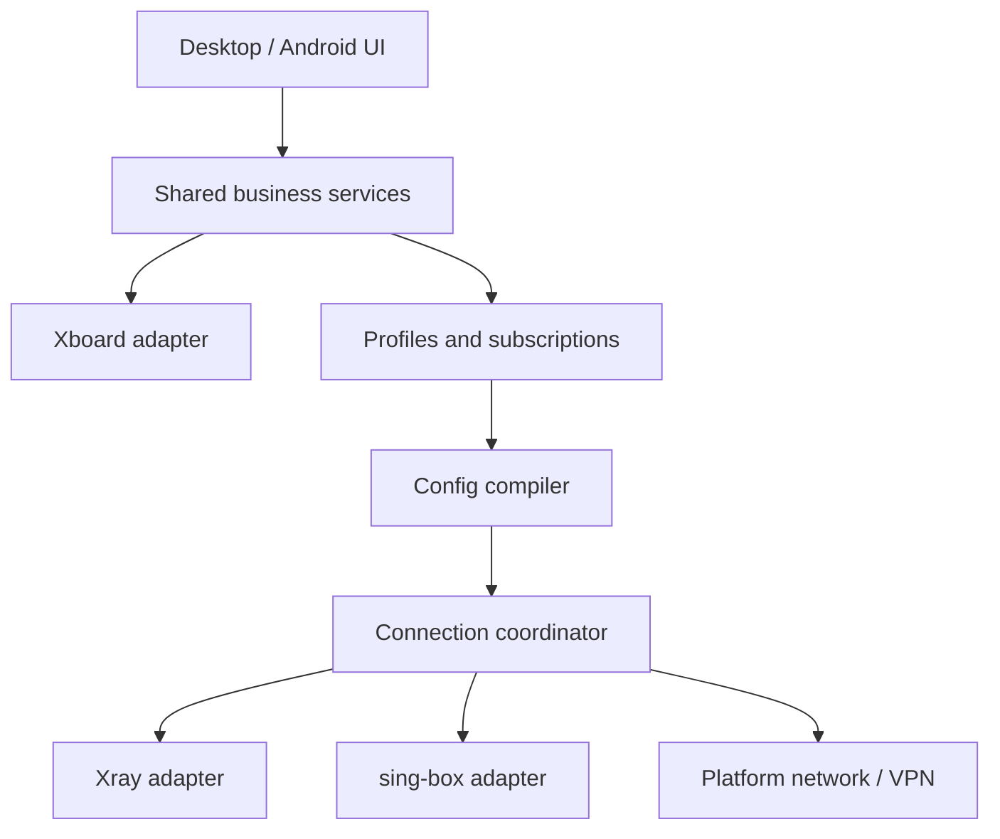

# 双核心 Xboard 客户端：工作设计流与验收基线

版本：0.1.0；日期：2026-10-14；状态：设计提案，尚未实施。

## 1. 目标与交付边界

生产一套支持 Xboard 用户业务、第三方订阅与手工节点的轻量代理客户端。Windows 和 Android 可以采用不同 UI 与平台实现，共享业务模型、规则语义与测试样本。桌面目标同时保留 Linux。核心使用 Xray 与 sing-box，通过可替换适配器实现，用户可选择核心。

本次交付是工作设计包。后续正式交付包括完整源码、依赖锁定、手动触发的 GitHub 编译工作流、安装/卸载配置、中文与英文开发文档、中文与英文使用文档、AI 项目上下文与变更记录。不在本次声称源码完成、工作流能运行或任意平台已经兼容。

Docker 可后置：其产品形态是无界面 HTTP/SOCKS 代理服务和可选容器内 TUN，不是把 Windows/Android GUI 放进容器，也不是重新部署 Xboard 服务端。

## 2. 核心原则与约束

| ID | 要求 | 验收方式 |
|---|---|---|
| R01 | 简易模式、专业模式、记住模式 | 重启、切换和取消记住的持久化测试 |
| R02 | 源码中默认 API/品牌 URL 为空，客户端可手工填写 | 全新安装无外联；填写后连接测试；第三方模式独立可用 |
| R03 | Xboard 登录、账户、用量、套餐信息、公告、工单 | 锁定版本契约测试与真实测试账号验证 |
| R04 | Xray/sing-box 双核心，运行时能力校验 | 两个核心独立完成连接；不支持项给出具体错误 |
| R05 | Windows 系统代理/TUN/PAC | OS 配置检查、流量路径和退出恢复测试 |
| R06 | Android VPN、全部应用/包含列表/排除列表 | 真机确认应用范围、网络切换与权限撤销 |
| R07 | 第三方订阅、节点链接、原生配置导入与手工节点 | 不登录 Xboard 也可导入和连接 |
| R08 | PAC 手工域名及 Geo 分类导入 | 规则预览、转换报告、PAC 执行测试 |
| R09 | 专业参数编辑与原生高级配置 | 编译预览、核心检查、失败回滚 |
| R10 | i18n，默认系统语言，支持手动语言覆盖 | zh-CN/en、占位符、复数、系统切换与长文本测试 |
| R11 | Windows/Linux x64/x86/arm64；Android v8a/v7a/x86 | 每个目标分别记录编译、启动、连接证据 |
| R12 | 手动 GitHub 构建入口和统一编译实现 | 入口矩阵展开检查；同一源码版本统一产物标识 |
| R13 | 可选 Docker amd64/386/arm64 | 镜像架构检查和代理连接冒烟 |
| R14 | 中英文开发与使用文档、AI 修改机制 | 文档覆盖矩阵、术语一致、修改记录完整 |
| R15 | 凭据保护、事务化网络恢复、低权限 UI | 脱敏、凭据隔离、崩溃恢复和权限测试 |
| R16 | 轻量与可维护性 | G1 测量基线、模块约束、资源预算门禁 |

不得默认加载生产 API，不得嵌入账号、面板管理员密钥或节点管理密钥。订阅 URL 中的 token 也按秘密处理。不能因为 Xboard 未配置、不可用或会话过期而禁止独立第三方配置。

## 3. 四个独立设置维度

| 维度 | 值 | 含义 |
|---|---|---|
| UI 模式 | simple / professional | 展示哪些操作 |
| 流量接入 | system_proxy / tun / pac / local_proxy | 流量怎样进入本地核心 |
| 路由策略 | rule / global / direct | 已进入核心的流量如何选择出口 |
| Android 应用范围 | all / include / exclude | 哪些应用进入 VPN |

Android 的“全部应用”不等于路由“全局代理”：全部应用进入 VPN 后仍可按规则分流。桌面系统代理、PAC、TUN 首轮互斥；切换时完整恢复上一模式再接管新模式。专业模式后续如增加组合模式，必须另建 ADR 与冲突测试。

记住模式使用 `rememberUiMode` 与 `preferredUiMode`。全新安装默认 simple；记住开启时启动选择上次模式；关闭后本次会话保留当前模式，下次启动回到 simple。两种 UI 使用同一个配置仓库，不得清空专业配置。退回简易模式时若当前有高级覆盖，显示“高级配置仍在生效”，可查看摘要、备份后重置。

## 4. UI 信息架构

### 4.1 简易模式

建议四个主入口：连接、账户、工单、设置。连接页包括一个连接按钮、真实运行状态、核心选择、节点选择、最近延迟与必要的连接方式选择；不显示复杂路由表。账户显示登录/退出、用量、总额度、到期时间、套餐和公告；服务端能力不存在时说明原因。工单包含列表、详情、创建、回复和关闭，以目标服务端实际支持为准。设置包含 API 地址、测试连接、语言、模式/记住、自动启动与平台专属设置。

Windows 简易设置提供系统代理/TUN/PAC；Android 提供 VPN 和应用范围；Linux 提供桌面代理/TUN/PAC，但根据桌面环境说明接管范围。空 API 地址时引导填入地址，同时保留“独立配置”入口。注册、找回密码、套餐购买/续费和支付首轮可打开用户自己填写的面板网页地址；web URL 不得根据 API URL 猜测，更不能在 URL 携带密码/token。

### 4.2 专业模式

入口包括仪表盘、配置/订阅、节点/出口组、路由、DNS、连接、日志、规则资源、账户/工单、平台设置、开发诊断。配置可新建、复制、备份、导入/导出；订阅可单独更新、定时更新和查看失败原因；支持节点参数、TLS、传输、DNS、端口、监听、路由优先级、出口选择组、测速策略、TUN MTU/IPv6/排除网段、PAC 域名、自定义规则、核心原生配置。

能力驱动表单：每个字段标记支持的核心版本/平台；不兼容参数不能隐藏后静默忽略。连接明细、实时切节点、测速组等只在适配器实际提供时可用；Xray 与 sing-box 不要求管理 API 完全相同。没有连接列表能力时显示未提供，不用日志猜造完整连接表。

高级原生编辑分为“结构化配置”和“核心原生配置”两种配置类型。原生类型属于一个核心，不能自动切换到另一个核心；可复制并尝试转换，显示完整转换损失。默认不运行远程脚本、不执行 Clash YAML 中的脚本。未知字段保存在隔离区并列出，不混入已验证的结构化配置。

## 5. 技术路线与架构

### 5.1 建议候选

桌面：C++20 + wxWidgets 原生 GUI、CMake；业务：Go 公共包和普通权限后台服务；核心：固定版本 Xray/sing-box sidecar；Android：Kotlin + Jetpack Compose + VpnService + Go bindings/AAR。此选择是为保留 x86、减少内置浏览器运行时的设计判断，不是已完成兼容性验证。wxWidgets 提供原生跨平台 UI 方向，但每个架构仍需 G1 探针。[S6]

不直接把 Clash Verge 的 Tauri/mihomo 配置拼接到双核心；参考其配置、托盘、日志、连接管理体验。Clash for Android 作为历史 UI/服务设计参考；其指定原仓库本次无法读取，后续须提供可验证的来源或固定快照。不得任意使用同名第三方 fork 替代。Qt 是备选，但当前官方支持列表没有 Windows/Linux x86，不能据此承诺所有 32 位平台。[S2][S7][S8]

G1 要验证：桌面 GUI、Go 服务、两种核心、TUN 驱动/桥接、Android AAR/JNI 四者架构匹配。Android 优先研究单一 AAR 包含业务包装与两个核心，避免多个独立 Go runtime；固定依赖能否共存必须编译验证。若冲突，先锁定兼容组合；仍失败则评估独立进程或其他绑定路线并记录 ADR，不得只交付单核心。

### 5.2 模块职责

| 模块 | 职责 | 禁止承担 |
|---|---|---|
| DesktopUI / AndroidUI | 页面、输入校验、用户交互、语言 | 直接写系统路由或拼接核心配置 |
| PanelAdapter | Xboard 用户认证、用量、工单、业务能力 | 管理员/节点后台 API |
| SubscriptionService | 拉取、解码、更新、来源和错误报告 | 执行订阅中的脚本 |
| ProfileRepository | 配置、节点、版本、秘密引用、迁移 | 明文凭据日志 |
| ConfigCompiler | 标准模型到 Xray/sing-box 配置 | 静默丢弃不支持的字段 |
| RuleResourceService | Geo/规则集读取、转换、PAC 子集生成 | 将任意正则等价宣称为域名后缀 |
| CoreAdapter | 核心检查、启动/停止、能力、运行统计 | 自行无记录接管系统网络 |
| ConnectionCoordinator | 单一连接事务、取消、回滚、代次 | 并发提交多个核心和多套网络图 |
| PlatformNetwork | 系统代理、DNS、路由、VPN、PAC 接管 | 业务 UI 或账户请求 |
| PrivilegedBroker | 桌面受限特权操作、所有权恢复 | 任意命令执行或任意文件写入 |
| SecretStore / Diagnostics | 系统密钥保存、脱敏事件和诊断包 | 上传原始凭据或自动遥测 |

数据流：用户配置或订阅 → 解析报告 → 标准 Profile/Node/Rule/DNS 模型 → 核心能力校验 → 配置编译 → 核心原生检查 → 连接事务 → 健康检查 → 提交状态。UI 显示已提交的运行状态；保存配置、进程存在或端口开放都不能单独代表代理已经可用。

### 5.3 计划源码目录

| 路径 | 内容 |
|---|---|
| `apps/desktop/` | wxWidgets UI、系统集成、CMake |
| `apps/android/` | Kotlin UI、VpnService、权限、Gradle |
| `shared/domain/` | Profile/Node/Rule/DNS/PanelAccount 模型 |
| `shared/panel/` | 版本化 Xboard API 适配与 DTO |
| `shared/subscription/` | URI/Base64/YAML/JSON 解析器 |
| `shared/compiler/` | 两个配置生成器及能力检查 |
| `shared/rules/` | Geo 读取、标准规则及 PAC 编译器 |
| `runtime/` | 协调器、适配器、IPC、恢复记录 |
| `platform/` | Windows/Linux 特权服务、Android 核心桥接 |
| `schemas/` | 配置、API、IPC、迁移模式 |
| `locales/` | 统一翻译源及资源生成器 |
| `build/` | 依赖锁、目标清单、构建与打包脚本 |
| `tests/` | 契约、转换、系统集成、受控代理端点 |
| `docs/zh-CN/`、`docs/en/` | 开发与使用文档 |
| `docs/adr/`、`docs/changes/` | 决策和修改记录 |
| `.github/workflows/` | 手动入口与复用任务 |

## 6. API 与数据契约

### 6.1 Xboard 适配

默认设置建议：`panel.apiBaseUrl=""`、`panel.webBaseUrl=""`、`panel.apiProfile="auto"`；可配置请求超时、API 前缀与版本适配档案。界面填写 API 时解析 URL，拒绝含凭据的 URL；默认 HTTPS。开发测试 HTTP 必须单独开启并显示测试状态；不得全局关闭 TLS 验证。

API 基线必须从目标 Xboard 的固定 commit 的 routes、middleware、controller、resource 和认证返回值逐项确定。仓库主页本次已核对，但具体路由文件没有成功读取；以下是客户端抽象操作，不是确认过的路径、方法或字段。禁止把网上 V2board 示例接口直接当作实际 Xboard 契约。[S1]

| 客户端操作 | 输入 | 输出/注意 |
|---|---|---|
| `discoverPanel` | 地址、档案 | 可用 API 版本/业务能力或未识别报告 |
| `login` | 邮箱、密码、额外认证字段 | 秘密引用、会话有效期、挑战要求 |
| `getAccount` | 会话引用 | 账户、计划、额度、到期、服务端单位 |
| `getTraffic` | 时间范围 | 服务端权威用量及更新时间 |
| `getSubscriptionDescriptor` | 用户会话 | 秘密 URL 引用、格式、元数据 |
| `listAnnouncements` | 游标 | 列表与未读状态（若提供） |
| `listTickets/getTicket` | 分页/ID | 内容、状态和权限 |
| `createTicket/replyTicket/closeTicket` | 内容/ID | 更新结果；提交不能盲目自动重试 |
| `logout` | 会话引用 | 按实际服务端撤销能力执行，本地始终清理 |

正式阶段建立 `api-map.json`：operation、method、path、request/response DTO、auth header 语义、错误码、源码定位和脱敏样本。不假设 Authorization 一定是 Bearer，不假设存在 refresh-token。401 引导重新登录；429 遵守退避；5xx 保留可用配置，显示业务不可用。切换服务器不能把旧 token 发到新主机；HTTPS 重定向跨主机不传认证头。

面板用量与本地代理统计分别标注来源。额度字节、计费周期和倍率按服务端契约计算，不能以本地上传/下载统计替代面板用量。认证请求默认直连；如用户启用通过代理访问面板，要提供启动依赖环检测。

### 6.2 内部 IPC 与核心契约

普通桌面业务服务通过有 ACL 的本地 pipe/Unix socket 接收版本化 JSON RPC；不要默认开放公网 HTTP 管理端口。GUI 和服务握手检查 protocolVersion/schemaVersion。Android 使用绑定服务/AAR 接口，对应同一抽象操作。特权 broker 使用另一条受限 IPC，只接受经过身份/路径校验的操作，不接受 shell 命令。

| 接口 | 主要参数/返回值 |
|---|---|
| `GetCapabilities` | 平台、核心版本、协议、接入方式、统计和热更新能力 |
| `ValidateProfile` | profile → 字段级错误、警告、转换损失 |
| `CompileProfile` | profile/core → 编译结果、hash、脱敏预览 |
| `Start/Stop` | operationId、profileRevision；幂等停止 |
| `GetRuntimeState` | state、generation、activeCore、lastError、health |
| `SwitchNode` | nodeId；支持热更新则应用，否则事务重启 |
| `SetNetworkMode` | 接入方式；启动/恢复有序执行 |
| `WatchEvents` | 事件序号、脱敏日志、状态、统计；有背压和丢弃计数 |
| `RecoverNetwork` | 只恢复本客户端拥有的网络设置 |

统一错误结构：`code`、`messageKey`、`fieldPath`、`retryable`、`operationId`、`detailsRedacted`。配置与事件必须携带 schemaVersion。不要把完整 token 放在 RPC 错误中。

### 6.3 订阅与标准配置

支持目标：节点 URI 列表、Base64 节点列表、Clash 兼容 YAML、Xray JSON、sing-box JSON。格式探测与单格式解析分离。初始标准协议集合为 SS/VMess/VLESS/Trojan，具体 TLS/Reality/传输字段依固定核心能力验证；其他协议通过扩展矩阵或原生配置支持。不能宣称任何 Clash 配置都可无损转成两种核心。

节点保存来源 ID、稳定节点 ID、原始格式摘要、认证秘密引用、传输/TLS 参数、目标核心能力约束。以明确的 ID 或规范化参数摘要保持选择，不能只用显示名称匹配。订阅更新生成候选快照，解析和校验完成后原子替换，失败保留旧快照。手工覆盖独立存储，不被订阅刷新覆盖；移除当前节点时要求重新选择或应用预先配置的回退，不静默连到任意节点。

限制响应体/解压后大小、节点数、解析深度、跳转次数和超时；禁止 YAML 不安全构造、任意文件路径加载和订阅脚本执行。导出默认脱敏；含秘密备份需明确选择加密导出。

## 7. 核心与平台网络

### 7.1 双核心

桌面默认只运行一个核心。Xray 和 sing-box 配置各自由独立编译器生成，并调用各自锁定版本的原生配置检查。通过公共 capability 模型说明协议、TUN、统计、实时切换和路由差异。核心的管理接口限制到 loopback 或本地 IPC，并按能力加认证；端口随机/冲突检测。

Xray 当前源码资料已经包含 TUN 输入支持，不能沿用“Xray 永远没有 TUN”的旧假设；但路由、DNS 和 Android FD 接管必须针对锁定版本验证。优先探针原生 TUN；若目标架构原生 TUN 不可用，评估 TUN-to-SOCKS 桥接并单独测试 UDP/DNS/IPv6，不能借用另一代理核心后仍显示为纯 Xray。[S3]

Android 两种核心都由 VpnService 提供 FD、受保护 socket 和网络变更回调。处理授权拒绝、撤销、前台服务、应用列表和系统网络切换。系统只允许一个活动 VPN；不会提供等同 Windows 的一键全设备“系统代理/PAC”接管。可提供本地 HTTP/SOCKS 和 PAC URL 供支持它的应用手工配置，但必须标注范围。[S4]

### 7.2 连接事务与恢复

状态机：`stopped → validating → starting_core → preparing_network → connecting → running → stopping → restoring → stopped`；失败进入 `recovering`，完成恢复后 `failed`；无法恢复进入 `recovery_required`，提供明确恢复入口。每个操作有 generation 和取消标记，过期异步结果不能覆盖新状态。

启动桌面代理前快照网络设置；核心就绪后才设置系统代理/PAC；TUN 先准备必要接口与旁路再提交路由/DNS。退出、崩溃、更新、卸载均有恢复。使用持久化恢复 journal 和特权服务 watchdog，标记原值、应用值、资源所有者和阶段。恢复时比较当前值是否仍属于本客户端，避免覆盖用户或其他软件的后续修改。冲突时报告需处理，不强行写回。不能承诺 SIGKILL 后依赖核心进程自身完成清理。

核心出口 socket、代理服务器地址解析、DNS bootstrap 与控制请求要有明确防环路线；IPv6 按支持启用，否则显示限制并采取明确策略，不能无声泄漏。正常模式默认失败后恢复直连；如后来增加断网保护，作为单独专业选项和另一套验收。

### 7.3 平台接管边界

| 平台 | 系统代理 | TUN/VPN | PAC |
|---|---|---|---|
| Windows | 当前用户代理设置；WinHTTP 独立且首轮不默认改 | 受限服务、架构匹配驱动/依赖、路由/DNS 恢复 | 本地 PAC HTTP 服务与 OS 自动脚本 URL |
| Android | 首轮只提供本地代理，不宣称全系统接管 | VpnService，全应用/包含/排除 | 导出或提供 PAC URL，应用需自行支持 |
| Linux | 首轮 GNOME 集成；其他环境说明并提供手工设置 | 特权服务/Polkit，明确 DNS 管理器 | GNOME 设置或手工 PAC URL，应用行为需验证 |
| Docker | 对外 HTTP/SOCKS，默认只映射主机 loopback | 默认关闭；可选 /dev/net/tun + 最小 NET_ADMIN | 可选提供 PAC 文件，不修改宿主代理 |

## 8. PAC 与 Geo 规则

`geodomain:gfw` 视为用户输入别名；内部使用资源 ID + 类别（如 geosite 数据集中的 gfw 类别），不直接写到任意核心配置。数据集是否有该类别必须检查。Xray Geo 数据与 sing-box 规则集不是同一种文件格式；sing-box 官方资料说明 geosite 已在 1.12.0 移除，所以新适配器走 rule-set，不生成失效的旧 geosite 字段。[S5]

转换流：本地选择/用户指定 URL → 校验 hash/格式/类别 → 标准规则列表 → 分别编译 Xray 规则、sing-box rule-set、PAC 域名子集。资源版本、来源、许可证、hash、类别数量、支持/丢弃条目进入报告。

PAC 支持精确域名和后缀；通配符、关键词与正则分别标记语义。不能无损转换的正则、IP 网段、进程、端口、复合规则不静默近似；默认阻止导入，用户查看损失报告后可明确选择仅导入支持的子集。优先级为用户直连例外 → 用户代理域名 → 导入域名 → 默认动作。PAC 只决定使用本地代理或 DIRECT，不等同于 TUN 的全流量路由。

默认 PAC 不调用会阻塞的 DNS 查询；转义输入，拒绝代码注入；local HTTP 只绑定 loopback，用固定脚本路径、版本/hash 避免旧缓存，停机时恢复自动脚本设置。性能用 1k/10k/50k 域名样本测量，域名去重和索引生成，大资源懒加载。

## 9. i18n、存储与轻量指标

语言优先级：用户指定语言 → 系统首选语言映射 → en。首轮提供 zh-CN 和 en；其他语言以后添加。翻译源采用稳定 key、参数定义和复数信息，构建时生成桌面与 Android 资源；日期/数字/流量单位本地化，不用字符串拼接。日志技术字段稳定，UI 错误翻译；服务端用户内容不自动翻译。资源检查覆盖缺失 key、参数数量、长文本、RTL 布局能力与屏幕阅读标签。

业务配置使用 SQLite 与版本化 JSON；数据库不保存明文密码/token。Windows 使用 DPAPI/Credential Manager，Android 使用 Keystore 保护密钥，Linux 使用 Secret Service；无钥匙环时默认只保存会话或明确选择加密保险库，不退回明文。更换服务器隔离账号和缓存；备份/迁移有 checksum、版本、原子写入与回退。

轻量是可测量目标：GUI 不内置 Chromium；只运行所选核心；日志环形缓冲默认总额 20 MiB；节点测速限制并发，空闲停止无用轮询；Geo 资源按需加载；Android 按 ABI 分包。G1 建立硬件/系统/测试配置/核心版本基线，再冻结包体、空闲 RSS、连接 RSS、首次启动、连接延迟预算。暂定优化目标：桌面空闲 GUI+业务服务 RSS ≤120 MiB，普通双核心分发压缩包 ≤100 MiB（不含可选 Geo 资源）；不是已测性能。超预算必须有测量和 ADR，不能为追求包体删除目标架构/核心。

## 10. 多架构构建计划

### 10.1 目标命名与产物

用户说的 amd32 统一规范为 x86 / Go `386`；arm 默认指 arm64。Android v7a 是 32 位 ARM，x86 是 32 位 Intel，不是 Android64。Android x86_64 为可选附加目标，不替代 x86。

| targetId | 目标 | 核心架构 | 计划产物 | 构建路径与关卡 |
|---|---|---|---|---|
| windows-amd64 | Windows x64 | amd64 | zip + installer | Windows runner + MSVC x64 |
| windows-386 | Windows x86 | 386 | zip + installer | Windows runner + MSVC Win32，依赖/驱动专检 |
| windows-arm64 | Windows ARM64 | arm64 | zip + installer | MSVC 交叉编译，ARM 真机/runner 运行验证 |
| android-arm64-v8a | Android ARM64 | arm64 | signed APK | Linux runner + Gradle/NDK/bindings |
| android-armeabi-v7a | Android ARMv7 | arm/7 | signed APK | 32 位 AAR/JNI 探针和真机 |
| android-x86 | Android x86 | 386 | signed APK | 32 位 AAR/JNI 探针与兼容设备/模拟器 |
| linux-amd64 | Debian/Ubuntu x64 | amd64 | deb + tar.gz | 选定最低 glibc 的构建容器 |
| linux-386 | Debian/Ubuntu i386 | 386 | deb + tar.gz | 固定提供 i386 依赖的环境；不假设所有 Ubuntu 有完整 i386 |
| linux-arm64 | Debian/Ubuntu ARM64 | arm64 | deb + tar.gz | 交叉/原生 runner；目标环境运行测试 |
| docker-amd64 | linux/amd64 | amd64 | OCI image | headless 服务与两核心 |
| docker-386 | linux/386 | 386 | OCI image | 基础镜像 manifest 与依赖独立检查 |
| docker-arm64 | linux/arm64 | arm64 | OCI image | Buildx/QEMU 或原生，运行连接探针 |

目标 OS 暂定：Windows 10/11 与 Windows on ARM；Linux 的具体 Debian/Ubuntu 最低版本和 i386 测试发行版由 G0 确定；Android minSdk 由锁定核心/NDK/bindings 能力共同决定，建议先评估 API 26 起，不先承诺更低版本。32 位 GUI 可构建不表示在 64 位系统上模拟测试即可证明 32 位系统兼容。所有目标状态分开记录 `planned/build_passed/runtime_passed/blocked/deferred`，本包全部为 planned。

### 10.2 手动入口

所有生产编译入口使用 `workflow_dispatch`。上传源码不自动生产发布。可以有轻量 push/PR 校验，但不触发安装包编译；构建默认上传 Actions artifacts，不自动发布 GitHub Release 或推送镜像。用户手动勾选 publish 后才执行对应发布 job。

| 入口 | 范围 |
|---|---|
| `build-all.yml` | Windows+Android+Linux 全部必需架构；Docker 可选开关 |
| `build-windows.yml` | Windows all/amd64/386/arm64 |
| `build-android.yml` | Android all/v8a/v7a/x86，可选 universal |
| `build-linux.yml` | Linux all/amd64/386/arm64，补齐原列表缺少的 Linux 入口 |
| `build-docker.yml` | 三个 Docker 平台与可选 manifest/push；合并用户重复的 Docker 入口 |
| `build-arch.yml` | 按 amd64/386/arm64/all 过滤桌面/Linux/Docker；Android 映射 amd64→可选 x86_64、386→x86、arm64→v8a；v7a 用单独 armv7 选择 |
| `build-common.yml` | Windows x64+x86、Linux x64+x86、Android v8a+v7a；默认无 Docker |

实现上这些入口只负责参数，把 target manifest 交给复用的 `reusable-desktop.yml`、`reusable-android.yml`、`reusable-docker.yml`；同一构建命令不得在七个文件里复制维护。`build-arch` 的平台开关默认 Windows+Linux，Android/Docker 按显式选择加入；不能把 Android v7a 误判为 amd32。

输入建议：source ref、preset/arch、include_docker、build_type、artifact_only/publish、release_tag。默认当前所选 ref，记录解析后的 commit SHA；明确校验 ref 和 tag 匹配。同次构建固定一份锁文件快照，不在每个 job 获取 latest。

版本锁定：app、Xray/sing-box commit、Go、CMake、wxWidgets、编译器、JDK、Gradle、AGP、Kotlin、NDK、Android SDK、资源 hash、GitHub Actions SHA、基础镜像 digest。首轮由 G0/G1 选定并写 `versions.lock.json`；占位锁文件不得进入发布构建。核心可由固定源码编译；用户应用源码在 GitHub 构建，不依赖本地预编译二进制。

工作流需做：dependency/architecture preflight → checkout fixed SHA → compile → 单元/契约/核心 config check → package → 架构/依赖检查 → 运行冒烟（可运行平台）→ SBOM/checksum/build-report → artifacts。matrix fail-fast=false 收集全部失败，最终汇总有目标失败则整体失败；禁止 continue-on-error 后发布“全平台成功”。不能执行的 runtime 测试标为 pending，而不是 passed。

Android 没有用户签名密钥时提供明确标注的 debug/test APK；正式 release 要求稳定用户 keystore 与 Secrets，缺少时失败，不能临时生成随机 release key。Windows 可无 Authenticode 生成测试安装包，报告签名状态；正式签名属于后续用户配置，不把凭据提交源码。发布 job 单独提升权限；依赖缓存键包含锁文件 hash 和架构。

Docker 首轮延后也要保留构建契约；启用可选 Docker 而尚无实现时 preflight 明确失败。运行用户默认非 root，凭据通过挂载配置/secret，不在 Dockerfile 烘焙；镜像包含 headless manager 和所选核心，两核心不会同时运行。TUN 能力只影响容器命名空间，宿主路由属于另一个部署方案，不承诺自动接管宿主网络。优先产出三架构 OCI artifacts，用户选择 push 到 GHCR 后生成 manifest。

## 11. 工作流、阶段与交付门禁

| 阶段 | 实现工作 | 产物 | 通过条件 |
|---|---|---|---|
| G0 事实与版本冻结 | 审计指定参考源码、Xboard 契约、许可证、OS/ABI/工具链 | source-register、api-map、versions lock、ADR | 没有未知 API 被当作既成事实；必需目标都有路线 |
| G1 技术探针 | 所有必需架构 GUI/核心/绑定编译；Windows+Android 双核心网络探针；32 位重点 | probe 源码/手动 workflow/build report | 关键架构可编译；首轮平台双核心可连；阻塞有解决路线 |
| G2 模型与业务 | Schema、SecretStore、API adapter、订阅解析、i18n 与 UI 壳 | 标准配置、测试样本、双语言框架 | 无面板也可第三方导入；空 API 安全；迁移和契约测试通过 |
| G3 首轮可用 | Windows/Android 简易连接、账户/工单、双核心、VPN/系统代理 | alpha 源码/安装包 | 两平台代表架构端到端可用；网络退出恢复通过 |
| G4 完整定制 | Windows TUN/PAC、Android 应用范围、专业路由/DNS/原生编辑 | beta、能力矩阵、转换报告 | 关键功能无假开关；高级配置不会被简易模式破坏 |
| G5 平台与打包 | Linux 桌面，全部必需架构打包，所有手动入口，Docker 可选 | 发布候选构建与平台报告 | 必需平台构建/运行证据完整；目标失败不发布成功标志 |
| G6 文档与收敛 | 中英文开发/使用文档、AI 上下文、升级/卸载/恢复 | v1.0 source package、docs、release evidence | 下述收敛条件全部满足 |

每阶段按“目标 → 契约/设计 → 最小实现 → 自动检查 → 平台验证 → 缺陷修复 → 证据归档 → 状态更新”循环。一个阶段未通过，不直接堆叠新功能掩盖问题。G1 不要求完整产品 GUI，但必须使用正式候选技术和目标依赖，不能用 Hello World 替代核心/JNI/驱动验证。

## 12. 验证计划

| 测试 ID | 场景 | 成功证据 |
|---|---|---|
| T01 | 模式切换/记住/重启 | 四组合与高级配置保留 |
| T02 | 空 API、无账号、第三方订阅 | 无默认请求，独立连接成功 |
| T03 | 登录/挑战/失效/换服务器 | 会话隔离、准确错误、秘密脱敏 |
| T04 | 用量和工单 | 对照服务端数据；重复提交不会盲重试 |
| T05 | 两核心及不支持协议 | 核心版本/流量证据；字段级阻止和回滚 |
| T06 | Windows 系统代理/TUN/PAC | HTTP/TCP/UDP/DNS/IPv6 各适用路径、OS 快照 |
| T07 | Android 全应用/包含/排除 | 至少两应用对照；protected socket 无回环 |
| T08 | 权限撤销/核心崩溃/强杀/卸载/重启 | 网络恢复或明确 recovery_required，设置所有权保留 |
| T09 | Wi-Fi/移动网切换、睡眠恢复 | 代次正确，无重复核心，重连/失败可解释 |
| T10 | 五种导入、坏数据、未知字段、更新失败 | 转换报告与 last-known-good 保留 |
| T11 | Geo 类别缺失/正则/PAC 注入 | 拒绝或显式损失；域名测试与资源 hash |
| T12 | 所有手动入口 | 输入矩阵快照与实际产物 targetId 对照 |
| T13 | 架构与平台运行 | PE/ELF/JNI 机器类型、依赖、启动及受控代理流量 |
| T14 | 语言/长文本/无障碍 | 无漏 key、格式错误与截断关键操作 |
| T15 | 参数保存/版本迁移/高级编辑失败 | 原子写入、备份、校验错误与恢复 |
| T16 | 包体/RSS/启动与 PAC 压力 | 公开测量方法和冻结预算对照 |
| T17 | 可选 Docker | 各架构镜像启动、代理连通、默认端口/权限 |

用受控测试代理服务器验证路由和传输，不能只以公网网站可打开或 HTTP 状态码作为双核心证明。分别测试本地到核心、核心到代理服务器和代理到测试目标；捕获 egress/日志进行核对，测试数据不含真实用户秘密。CI 非特权 smoke 不代替 OS 接管真机测试。

阻断发布：凭据泄露、网络无法恢复、错误出口、静默删字段、伪造 API/用量、必需架构无法启动、模式切换破坏配置。普通样式缺陷按严重程度记录；有平台功能限制必须反映到 UI、能力矩阵与双语言文档。

## 13. 收敛目标 / Definition of Done

核心 v1.0：Windows、Android、Linux 全部必需目标已分别通过构建和运行验证；两核心在每个平台族有连接测试，架构专属 TUN/绑定依赖有证据。简易/专业、记住模式、Xboard 用户业务、第三方配置、规定的平台代理方式、Geo/PAC、i18n、恢复和手动构建全部完成。没有 P0/P1 未关闭缺陷。

若必需目标只能编译未能运行，允许提交 source-only/pre-release 包，明确列出验证缺口，不标为满足 v1.0。若用户后来调整架构/功能范围，先更新需求、目标清单和 ADR，再改变门禁。Docker 可明确为 deferred，不阻塞核心 v1.0；启用后单独达到 R13/T17 才宣布 Docker 完成。

正式源码从干净 checkout 仅凭文档、锁文件和用户提供的可选签名配置即可在 GitHub 手动构建。所有生产 API 默认为空；生成产物附 commit SHA、依赖版本、架构、测试状态、签名状态、SBOM 和 SHA256。更新保留用户配置/选择，卸载不留下代理/DNS/路由接管；迁移和恢复方法有双语言说明。

## 14. 正式双语言文档清单

| 开发文档（zh-CN/en） | 使用文档（zh-CN/en） |
|---|---|
| 架构、目录、模块边界、数据流 | 下载/识别架构、安装/卸载 |
| API/认证/DTO/错误与样本 | 填 API、登录、额度与工单 |
| Schema、版本、迁移与备份 | 简易/专业/记住模式 |
| 核心能力/配置编译/规则转换 | 核心/节点、第三方订阅和手工节点 |
| 平台权限、VPN、TUN、代理恢复 | Windows 三种方式、Android 应用范围、Linux 设置 |
| i18n 添加语言流程 | PAC 域名与 Geo 导入、专业参数 |
| 工具链、七入口、签名与镜像 | 手动构建、下载 artifacts、签名和更新 |
| 测试、诊断、性能与安全边界 | 常见错误、恢复网络、导出脱敏诊断 |
| AI 修改流程、ADR、变更/交接 | 功能/平台限制、Docker 可选部署 |

本设计包不冒充已存在软件的操作手册；正式手册需要根据实际 UI、参数和构建结果生成并逐步验证。

## 15. AI 工作流程与记录

AI 先读 AGENTS → 两种语言之一的设计 → spec → 当前状态/上一交接 → 相关代码/契约/锁文件 → 最近相关 ADR。每次只接受一个有界任务，使用模板声明需求 ID、目标平台、受影响 API/schema、改动文件、验收和回滚。

修改顺序：定位事实 → 写影响分析 → 小步实现 → 原生配置检查/针对性测试 → 对照目标矩阵 → 更新文档/变更记录 → 写交接。禁止把未运行测试写为 passed；禁止因架构构建失败删掉该架构；禁止随手升级核心/toolchain；禁止更改 API/schema 后不做迁移和契约测试。

记录格式分别为任务 Markdown、ADR Markdown、变更 Markdown 和 JSON 验证证据。状态文件保存当前 commit、阶段、完成需求、阻塞、未知项、下一唯一任务。项目规范高于模型推测；规范冲突或新技术限制通过 ADR 解决。文档变更保持中英文同步，术语和需求 ID 一致。

## 16. 未决事项与风险收敛

| 项目 | 当前状态 | 最迟解决阶段 |
|---|---|---|
| 实际 Xboard fork/version/commit、认证与完整用户业务路径 | 未指定/未核实；不能生成确认接口 | G0；先审计参考版本，提供外部适配档案 |
| 软件正式名称、包名、签名身份 | 暂用工作名；不阻碍探针 | G0/G3 |
| 三个桌面 ABI、Android x86/v7a 的依赖/驱动支持 | 仅计划；需源码构建与运行 | G1/G5 |
| 单 AAR 中双核心依赖兼容 | 仅候选 | G1 |
| Clash for Android 可验证源快照 | 指定仓库本次不可读 | G0 |
| Linux 最低 glibc、i386 发行版、Android minSdk | 未冻结 | G0/G1 |
| 参考代码复用的许可和署名 | 逐文件/锁定版本核对，独立 UI 实现优先 | G0/发布前 |
| Docker 是否纳入首轮 | 默认后置，构建入口保留 | G5 |
| “常用”是否包含 Linux | 默认包含 Linux x64/x86；可修改 preset 不改底层目标 | G0 |

这些未决项允许先推进源码审计和探针；不要求现在提供生产服务器账号。涉及真实 Xboard 的端到端验证在获得测试环境后执行，期间契约样本不得虚构成真实响应。
